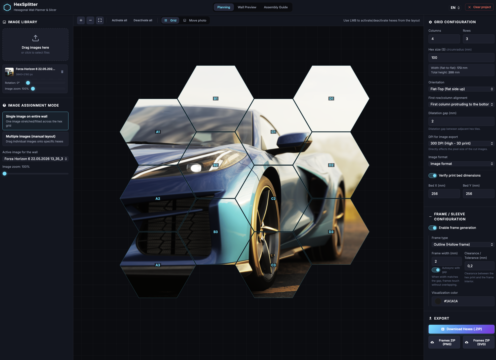

# ⬡ HexSplitter — Hexagonal Wall Planner & Slicer

[English below](#english)



HexSplitter to aplikacja webowa do planowania dekoracji z heksagonów, kadrowania zdjęć oraz generowania elementów do druku 3D. Przetwarzanie zdjęć odbywa się w przeglądarce, bez backendu i kont użytkowników.

## Uruchomienie

Wymagane: Node.js 22+ i npm oraz współczesna przeglądarka z Canvas 2D, ES Modules i IndexedDB.

```sh
git clone https://github.com/ventus34/hex_splitter.git
cd hex_splitter
npm ci
npm start
```

Otwórz **http://127.0.0.1:8080**. Opcjonalnie ustaw port: `PORT=8081 npm start`.

Można też opublikować pliki statyczne (`index.html`, `css/`, `js/`, `vendor/`). Używaj HTTP/HTTPS; bezpośrednie otwarcie `index.html` przez `file://` nie jest obsługiwanym sposobem uruchamiania modułów.

Do zwykłego używania aplikacji na hostingu nie trzeba instalować Node. JSZip jest dołączony lokalnie; pobieranie plików korzysta z natywnego API przeglądarki. Opcjonalna czcionka Inter pochodzi z Google Fonts, z lokalnym fontem zastępczym.

## Funkcje

- Siatka flat-top/pointy-top, dwa warianty przesunięcia, szczeliny i edycja układu przez dodawanie, usuwanie lub przycinanie pojedynczych heksów.
- Trzy tryby obrazów: jeden na całą ścianę, osobne zdjęcia oraz obraz rozciągnięty na grupę heksów (span).
- Obrót, zoom i przesuwanie kadrów; biblioteka zdjęć przechowywana lokalnie.
- Podgląd ścienny z ramkami, etykietami i miarką.
- Eksport kafelków PNG/JPEG do ZIP, przezroczystych grup PNG dla HueForge oraz ramek outline/backing/sleeve do ZIP STL.
- Instrukcja montażu z mapą, kodami, wymiarami przyciętych elementów i miniaturami. Zapis do PDF jest dostępny w oknie drukowania.
- Kompletny projekt ze zdjęciami zapisuje się jako `.hexproj`. Preset `.hexpreset` zawiera układ i ustawienia bez plików i przypisań zdjęć. Aplikacja otwiera również starsze kopie `.hexproj`.
- Cofanie i ponawianie do 100 stanów układu w bieżącej sesji: `Ctrl/Cmd+Z`, `Ctrl/Cmd+Shift+Z` lub `Ctrl+Y`. Dodanie i usunięcie zdjęcia, wczytanie pełnego projektu oraz reset rozpoczynają nową historię.
- Tylko jedna karta tej samej witryny edytuje projekt naraz. Pozostałe karty działają tylko do odczytu i mogą przejąć edycję.
- Interfejs PL/EN, układ mobilny, dotykowe zaznaczanie/przesuwanie i obsługa siatki klawiaturą.

### Edycja siatki

Wiersze i kolumny obowiązują po kliknięciu **Utwórz siatkę**. Następnie wybierz heks i kliknij jeden z przerywanych obrysów, aby dodać sąsiada. Tę samą akcję wykonują przyciski **+ kod** pod płótnem. W sekcji **Kształt** wybierz pełen heks, półheks lub własne cięcia. Głębokość cięcia to procent szerokości heksa mierzonej prostopadle do wybranego boku. Półheks odpowiada cięciu na 50%. Istniejący kadr pozostaje w tym samym miejscu po zmianie kształtu.

Strzałki wybierają heks, Tab prowadzi do jego ustawień, a Delete otwiera potwierdzenie usunięcia. Po usunięciu ostatniego elementu można dodać pierwszy heks od nowa. Na ekranie dotykowym dotknięcie wybiera heks, a przeciągnięcie przesuwa widok. Przy użyciu myszy widok przesuwa się prawym lub środkowym przyciskiem albo przez Shift + lewy przycisk. Kółko zmienia zoom.

**Zapisz preset** pobiera plik `.hexpreset`. **Wczytaj preset** zastępuje układ, kształty, grupy PNG i ustawienia, zachowując zdjęcia w bibliotece. Wczytanie można cofnąć jednym krokiem.

## Dane, import i ograniczenia

Autozapis korzysta z IndexedDB oraz kopii układu w localStorage, osobno dla danego adresu strony. Czyszczenie danych witryny usuwa zapis lokalny. Plik `.hexproj` służy jako przenośna kopia zapasowa. Nie przechowuj jedynej kopii pracy wyłącznie w pamięci przeglądarki.

Import najpierw sprawdza schemat, pliki i możliwość odczytania każdego obrazu, a następnie zastępuje projekt jedną transakcją. Błędny import zachowuje dotychczasowy projekt. Obecne limity obejmują siatkę o rozpiętości do 25 wierszy i 25 kolumn z maksymalnie 625 heksami, wielkość archiwum 250 MiB i zasobów po rozpakowaniu 300 MiB. Szczegóły są w `js/project-validation.js`.

Eksport pracuje na kopii ustawień i źródeł obrazów. Jednocześnie może działać jeden eksport. Interfejs pokazuje postęp i pozwala anulować zadanie. Archiwa ZIP, w tym kopie projektu `.hexproj`, są zapisywane strumieniowo. Dane kolejnych plików trafiają do wybranego pliku porcjami, bez składania całego ZIP-a w jednym Blobie. Generator nadal tworzy Blob bieżącego pliku, a eksport kafelków utrzymuje kopie źródeł obrazów. Zapis używa ZIP32 bez kompresji. Przy dostępnej obsłudze zapisu plików limit techniczny wynosi poniżej 4 GiB. Przeglądarka musi obsługiwać `showSaveFilePicker` w bezpiecznym kontekście, a okno zapisu otwiera się po kliknięciu przycisku. Gdy API nie jest dostępne, aplikacja pobiera buforowany ZIP do 256 MiB. Anulowanie wyboru pliku, odmowa dostępu lub błąd zapisu kończą zadanie i nie uruchamiają pobierania zastępczego.

Pliki `.hexproj` zachowują limity zgodne z importerem: 250 MiB dla całego archiwum, 300 MiB danych po rozpakowaniu, 5 MiB dla manifestu JSON, do 50 MiB na obraz i 625 obrazów. Pozostałe eksporty mają limit archiwum poniżej 4 GiB przy strumieniowym zapisie albo 256 MiB w trybie buforowanym. Niezależnie od sposobu zapisu pojedynczy obraz wyjściowy jest ograniczony do 16 megapikseli, a łączne źródła obrazu eksportu do 64 megapikseli. Zmniejsz liczbę aktywnych kafelków lub DPI, jeśli zadanie przekracza limit.

Historia obejmuje ustawienia układu i kadry zdjęć, nie zawiera blobów obrazów i jest ograniczona do 100 stanów. Reset, wczytanie pełnego projektu oraz zmiana zawartości biblioteki zdjęć czyszczą historię. Cofanie/ponawianie jest sesyjne i nie przechodzi do innej karty ani po ponownym otwarciu aplikacji.

Blokada edycji jest wspólna dla kart w ramach tego samego originu. Aplikacja korzysta z Web Locks, a gdy API nie jest dostępne — z dzierżawy zapisanej w IndexedDB; karta tylko do odczytu może poprosić o przejęcie edycji.

Ostrzeżenie o stole dotyczy obrysu X/Y heksa lub ramki. Ramka z otworem wymaga dodatniej grubości ścianek. Jeżeli zerowa szczelina uniemożliwia eksport ramki, zwiększ szczelinę lub wybierz pełny podkład.

Serwer developerski nasłuchuje na `127.0.0.1`, udostępnia wyłącznie publiczne zasoby aplikacji i blokuje wyjście poza katalog. Dla innego hostingu należy skonfigurować równoważne nagłówki bezpieczeństwa — zobacz `server/static-server.js`.

## Panele PNG dla HueForge

W planerze wybierz **Grupy PNG**, zaznacz co najmniej dwa sąsiadujące aktywne heksy i kliknij **Zapisz grupę**. Lista paneli pozwala edytować skład i usuwać grupy. Grupy są niezależne od trybu obrazów `span`, zapisują się w `.hexproj` i obsługują undo/redo. Usunięcie członka lub zmiana siatki naruszająca grupę rozwiązuje ją w tym samym kroku historii.

**Fuga paneli** (0–50 mm, domyślnie 0) zmienia wyłącznie rozstaw w eksporcie, zachowując kadry i kształty przyciętych heksów. **Pobierz grupy PNG (.ZIP)** zapisuje jeden przezroczysty PNG na grupę. Nazwy, np. `panel_A1_A2_40.00x69.28mm.png`, zawierają fizyczny bounding box do ustawienia wymiarów w HueForge. Wymiary w mm są niezależne od zaokrąglania liczby pikseli przy wybranym DPI. Ustawienie `Original` wybiera największą gęstość kadru w grupie. Każdy heks grupy musi mieć przypisany obraz.

## Testy

```sh
npm ci
npx playwright install chromium
npm test
```

Można użyć zainstalowanego Chrome: `CHROME_CHANNEL=chrome npm test`.

```sh
npm run test:unit
npm run test:browser
```

Testy obejmują geometrię i topologię STL, granice stołu, bezpieczeństwo serwera, walidację danych, zapis/import/odtworzenie projektu, historię, blokadę kart, anulowanie i eksporty, a także działanie interfejsu w przeglądarce. Testy używają tymczasowego serwera localhost i osobnego profilu przeglądarki. CI uruchamia zestaw na Chromium. Szczegóły pokrycia opisuje [tests/README.md](tests/README.md).

## Struktura

- `js/app.js` — inicjalizacja i obsługa UI.
- `js/project-validation.js`, `js/project-store.js` — walidacja, schemat i trwały zapis projektu.
- `js/hex-math.js`, `js/grid-manager.js` — geometria i stan siatki.
- `js/image-processor.js` — obrazy i kadry.
- `js/wall-planner.js`, `js/preview-renderer.js` — renderowanie i interakcje.
- `js/frame-generator.js` — ramki STL.
- `js/export-manager.js`, `js/download.js` — eksport i pobieranie.
- `js/panel-groups.js`, `js/panel-controller.js`, `js/panel-export.js` — grupy paneli HueForge, ich obsługa i renderowanie PNG.
- `vendor/` — lokalna biblioteka JSZip i jej licencja.
- `server/`, `tests/` — serwer statyczny i testy regresji.

## English

HexSplitter is a browser-based hexagonal wall planner, image slicer and generator of printable STL frames. It processes images locally.

Run with Node.js 22+ using `npm ci` and `npm start`, then open **http://127.0.0.1:8080**. A static HTTP/HTTPS host can serve `index.html`, `css/`, `js/`, and `vendor/`.

Choose rows and columns and select **Create grid**. Select a hex to add available neighbors, remove it after confirmation, or edit its shape. Shape options include a full tile, a half tile and cuts from multiple sides. Arranging and cutting tiles works with the keyboard and touch. Use Tab to reach the selected tile's controls, and Delete to confirm removal. Undo and redo store up to 100 layout and crop states in the current session.

Assign one image to the entire wall, individual images to tiles or an image across a span. Export tile PNGs or JPEGs, transparent PNG groups for HueForge, and printable frame STL files. HueForge group filenames include their exact physical bounding box rounded to two decimals. The assembly guide shows the wall map, tile codes, actual sizes and frame dimensions, and can be saved to PDF through the print dialog.

Use `.hexproj` for a complete portable backup, including the original images. Use `.hexpreset` to reuse a layout and settings without images or photo assignments. Opening a preset keeps the current photo library and supports undo. Legacy backups import with their original edge cuts. Local autosave uses IndexedDB and an optional localStorage layout backup. One tab edits the project at a time.

Run `npx playwright install chromium` and `npm test` for the full suite, or use `CHROME_CHANNEL=chrome npm test` with Google Chrome. Tests cover cut geometry, STL meshes, preset and project round trips, history, tab ownership, archive cancellation and browser behavior.
---

<sub>Projekt pierwotnie stworzony we współpracy z Antigravity (Google DeepMind).</sub>
