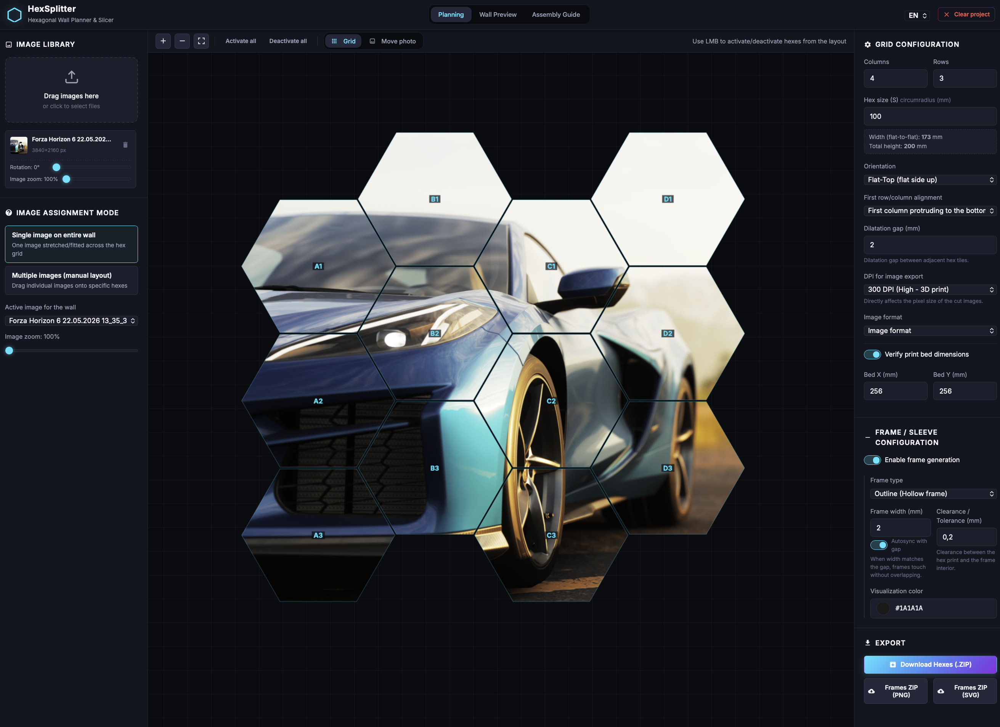

# ⬡ HexSplitter — Hexagonal Wall Planner & Slicer

[English below](#english)



HexSplitter to aplikacja webowa do planowania dekoracji z heksagonów, kadrowania zdjęć oraz generowania elementów do druku 3D. Przetwarzanie zdjęć odbywa się w przeglądarce, bez backendu i kont użytkowników.

## Uruchomienie

Wymagane: Node.js 22+ i npm oraz współczesna przeglądarka z Canvas 2D, ES Modules i IndexedDB.

```sh
git clone https://github.com/ventus34/hex_splitter.git
cd hex_splitter
npm ci
npm start
```

Otwórz **http://127.0.0.1:8080**. Opcjonalnie ustaw port: `PORT=8081 npm start`.

Można też opublikować pliki statyczne (`index.html`, `css/`, `js/`, `vendor/`). Używaj HTTP/HTTPS; bezpośrednie otwarcie `index.html` przez `file://` nie jest obsługiwanym sposobem uruchamiania modułów.

Do zwykłego używania aplikacji na hostingu nie trzeba instalować Node. JSZip jest dołączony lokalnie; pobieranie plików korzysta z natywnego API przeglądarki. Opcjonalna czcionka Inter pochodzi z Google Fonts, z lokalnym fontem zastępczym.

## Funkcje

- Siatka flat-top/pointy-top, dwa warianty przesunięcia, włączanie komórek, szczeliny i obcinanie brzegów.
- Trzy tryby obrazów: jeden na całą ścianę, osobne zdjęcia oraz obraz rozciągnięty na grupę heksów (span).
- Obrót, zoom i przesuwanie kadrów; biblioteka zdjęć przechowywana lokalnie.
- Podgląd ścienny z ramkami, etykietami, miarką, zawieszkami i symulacją ograniczonej palety AMS.
- Eksport kafelków PNG/JPEG do ZIP, ramek outline/backing/sleeve do ZIP STL, reliefów do binarnych ZIP STL i zawieszki Y do STL.
- Instrukcja montażu z mapą, wymiarami i miniaturami. Przycisk drukowania używa okna przeglądarki; PDF zapisuje się przez „Zapisz jako PDF”.
- Zapis i import plików `.hexproj` zawierających układ i oryginalne zdjęcia. Nowe pliki mają wersjonowany schemat; starszy format bez numeru wersji nadal jest obsługiwany.
- Cofanie i ponawianie do 100 stanów układu w bieżącej sesji: `Ctrl/Cmd+Z`, `Ctrl/Cmd+Shift+Z` lub `Ctrl+Y`. Dodanie/usunięcie zdjęcia, import i reset rozpoczynają nową historię; historia nie jest zapisywana w projekcie.
- Tylko jedna karta tej samej witryny edytuje projekt naraz. Pozostałe karty działają tylko do odczytu i mogą przejąć edycję.
- Interfejs PL/EN, układ mobilny, dotykowe zaznaczanie/przesuwanie i obsługa siatki klawiaturą.

W planerze strzałki wybierają komórkę, a Spacja/Enter przełączają jej aktywność w trybie siatki. Na ekranie dotykowym dotknięcie przełącza komórkę, a przeciągnięcie przesuwa widok. Przy użyciu myszy widok przesuwa się prawym/środkowym przyciskiem lub Shift + lewy przycisk; kółko zmienia zoom.

## Dane, import i ograniczenia

Autozapis korzysta z IndexedDB oraz kopii układu w localStorage, osobno dla danego adresu strony. Czyszczenie danych witryny usuwa zapis lokalny. Plik `.hexproj` służy jako przenośna kopia zapasowa. Nie przechowuj jedynej kopii pracy wyłącznie w pamięci przeglądarki.

Import najpierw sprawdza schemat, pliki i możliwość odczytania każdego obrazu, a następnie zastępuje projekt jedną transakcją. Błędny import zachowuje dotychczasowy projekt. Obecne limity obejmują siatkę do 25×25 komórek, wielkość archiwum 250 MiB i zasobów po rozpakowaniu 300 MiB; szczegóły są w `js/project-validation.js`.

Eksport pracuje na kopii ustawień i źródeł obrazów. Jednocześnie może działać jeden eksport danego zestawu kafelków/ramek/reliefów; postęp jest widoczny w interfejsie, a przycisk pozwala anulować zadanie. Relief jest generowany w module Worker, jeśli przeglądarka obsługuje wymagane API; w przeciwnym razie używany jest wariant głównego wątku. Kwantyzacja palety AMS podglądu również używa Workera z wariantem zastępczym. Archiwa ZIP, w tym kopie projektu `.hexproj`, są zapisywane strumieniowo: dane kolejnych plików trafiają do wybranego pliku porcjami, bez składania całego ZIP-a w jednym Blobie. Generator nadal tworzy Blob bieżącego pliku, a eksport kafelków utrzymuje kopie źródeł obrazów. Zapis używa ZIP32 bez kompresji; przy dostępnej obsłudze zapisu plików limit techniczny wynosi poniżej 4 GiB. Przeglądarka musi obsługiwać `showSaveFilePicker` w bezpiecznym kontekście, a okno zapisu otwiera się po kliknięciu przycisku. Gdy API nie jest dostępne, aplikacja pobiera buforowany ZIP do 256 MiB. Anulowanie wyboru pliku, odmowa dostępu lub błąd zapisu kończą zadanie i nie uruchamiają pobierania zastępczego.

Pliki `.hexproj` zachowują limity zgodne z importerem: 250 MiB dla całego archiwum, 300 MiB danych po rozpakowaniu, 5 MiB dla manifestu JSON, do 50 MiB na obraz i 625 obrazów. Pozostałe eksporty mają limit archiwum poniżej 4 GiB przy strumieniowym zapisie albo 256 MiB w trybie buforowanym. Niezależnie od sposobu zapisu pojedynczy obraz wyjściowy jest ograniczony do 16 megapikseli, a łączne źródła obrazu eksportu do 64 megapikseli. Zmniejsz liczbę aktywnych kafelków, DPI lub rozdzielczość reliefu, jeśli zadanie przekracza limit.

Historia obejmuje ustawienia układu i kadry zdjęć, nie zawiera blobów obrazów i jest ograniczona do 100 stanów. Reset projektu, import oraz zmiana zawartości biblioteki zdjęć czyszczą historię. Cofanie/ponawianie jest sesyjne i nie przechodzi do innej karty ani po ponownym otwarciu aplikacji.

Blokada edycji jest wspólna dla kart w ramach tego samego originu. Aplikacja korzysta z Web Locks, a gdy API nie jest dostępne — z dzierżawy zapisanej w IndexedDB; karta tylko do odczytu może poprosić o przejęcie edycji.

Symulacja AMS jest podglądem kolorów; STL nie zapisuje kolorów ani konfiguracji wielomateriałowej drukarki. Ostrzeżenie o stole dotyczy obrysu X/Y heksa lub ramki. Przed drukiem sprawdź wysokość, orientację, spasowanie i wynik w swoim slicerze.

Serwer developerski nasłuchuje na `127.0.0.1`, udostępnia wyłącznie publiczne zasoby aplikacji i blokuje wyjście poza katalog. Dla innego hostingu należy skonfigurować równoważne nagłówki bezpieczeństwa — zobacz `server/static-server.js`.

## Testy

```sh
npm ci
npx playwright install chromium
npm test
```

Można użyć zainstalowanego Chrome: `CHROME_CHANNEL=chrome npm test`.

```sh
npm run test:unit
npm run test:browser
```

Testy obejmują geometrię i topologię STL, granice stołu, bezpieczeństwo serwera, walidację danych, zapis/import/odtworzenie projektu, historię, blokadę kart, anulowanie i eksporty, a także działanie interfejsu w przeglądarce. Testy używają tymczasowego serwera localhost i osobnego profilu przeglądarki. CI uruchamia zestaw na Chromium. Szczegóły pokrycia opisuje [tests/README.md](tests/README.md).

## Struktura

- `js/app.js` — inicjalizacja i obsługa UI.
- `js/project-validation.js`, `js/project-store.js` — walidacja, schemat i trwały zapis projektu.
- `js/hex-math.js`, `js/grid-manager.js` — geometria i stan siatki.
- `js/image-processor.js` — obrazy i kadry.
- `js/wall-planner.js`, `js/preview-renderer.js` — renderowanie i interakcje.
- `js/*generator.js` — ramki, reliefy i zawieszki STL.
- `js/export-manager.js`, `js/download.js` — eksport i pobieranie.
- `vendor/` — lokalna biblioteka JSZip i jej licencja.
- `server/`, `tests/` — serwer statyczny i testy regresji.

## English

HexSplitter is a browser-based hexagonal wall planner, image slicer, and generator of printable STL frames, relief tiles, and Y-hangers. Images are processed locally. There is no backend or user account.

Run with Node.js 22+: `npm ci`, then `npm start`. Open **http://127.0.0.1:8080**. A static HTTP/HTTPS host can serve `index.html`, `css/`, `js/`, and `vendor/`; opening the app through `file://` is unsupported.

Assign one image to the entire wall, individual images to tiles, or an image across a group of tiles. Rotate, zoom and pan crops, preview frames and an AMS-style reduced palette, then export PNG/JPEG ZIPs, STL ZIPs, or the standalone hanger. The assembly guide uses the browser's print dialog, including Save as PDF. Undo and redo keep up to 100 layout/crop states for the current session (`Ctrl/Cmd+Z`, `Ctrl/Cmd+Shift+Z`, or `Ctrl+Y`); library changes, import, and reset clear that history. Only one tab per origin can edit at a time; other tabs are read-only until they take over.

Projects are autosaved locally in IndexedDB with a localStorage layout fallback. Export `.hexproj` backups to keep portable copies. Imports validate the entire project and decode images before replacing local data in one transaction. Legacy projects without a schema version remain supported. Grid size is limited to 25×25. ZIP archives, including `.hexproj` backups, are written to the selected file in chunks where the browser supports the File System Access API. It uses ZIP32 without compression and supports archives below 4 GiB; when the API is unavailable, a buffered download is limited to 256 MiB. The generator still creates one output Blob at a time, and image exports keep copies of their source images. `.hexproj` files keep the import-compatible limits: 250 MiB archive, 300 MiB unpacked data, a 5 MiB JSON manifest, images up to 50 MiB each, and up to 625 images. The save picker requires a secure context and a direct user action. Cancelling the picker, denying access, or a write error stops the save; it does not silently switch to a download. Per-output canvas and source image limits remain 16 and 64 megapixels. Exports show progress and can be cancelled. Relief generation and AMS palette quantization use module Workers where supported, with a main-thread fallback. Undo history is session-only and is not included in project backups.

On the planner canvas, use arrow keys to select a cell and Space/Enter to toggle it in grid mode. Touch supports tapping cells and dragging the view. The layout reflows for small screens.

Run `npx playwright install chromium` and `npm test` for the full suite, or `CHROME_CHANNEL=chrome npm test` with installed Google Chrome. Tests cover geometry, project persistence/import safety, history, tab ownership, streamed ZIP output and cancellation, export workers, server security, and browser behavior. Regression tests live in `tests/`.

AMS preview does not generate a multicolor printer project. Bed checks cover X/Y geometry; inspect height, fit and print settings in your slicer before printing.

---

<sub>Projekt pierwotnie stworzony we współpracy z Antigravity (Google DeepMind).</sub>
