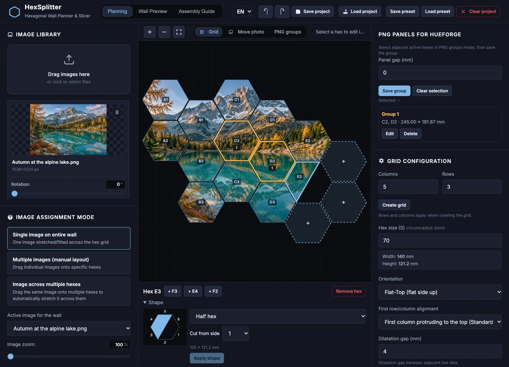
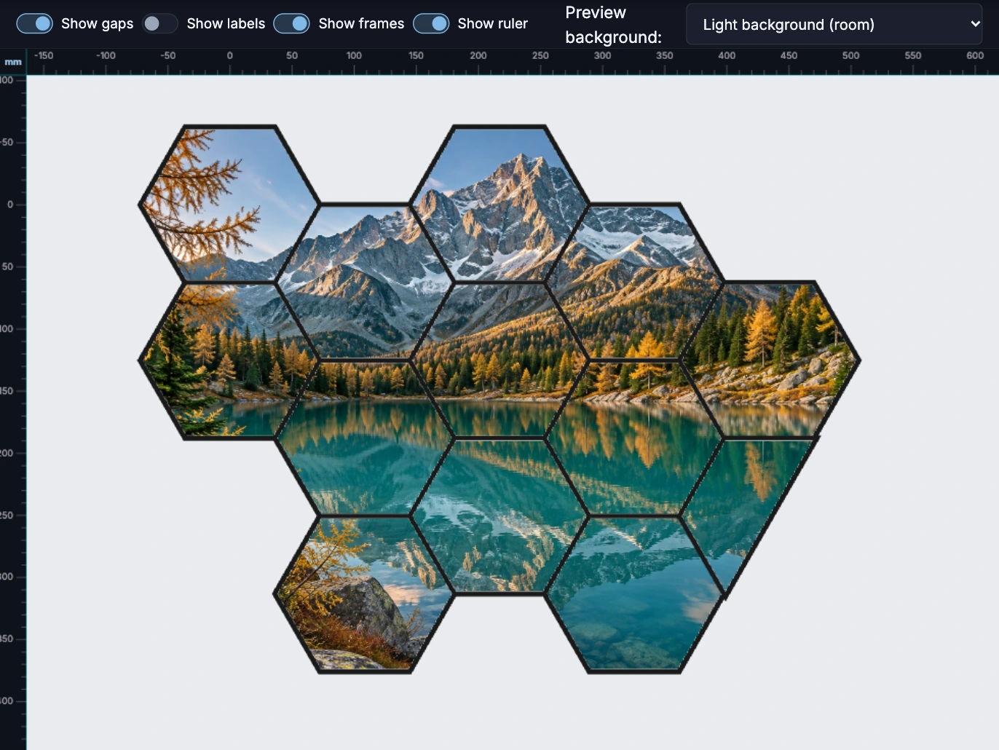
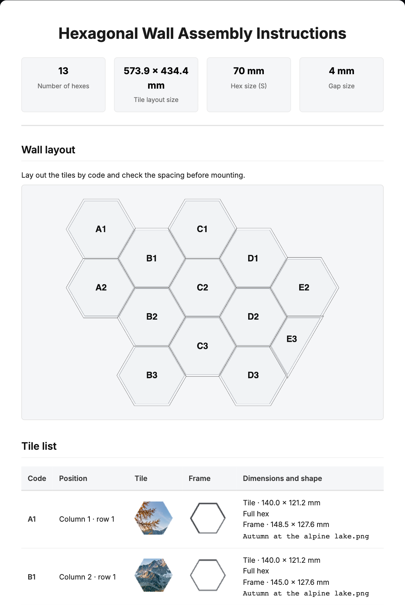

# HexSplitter

**Plan a hexagonal photo wall, slice your artwork into tiles, and generate 3D-printable frames.**

HexSplitter runs in your browser. It handles image processing locally and requires no account or backend.



## Quick start

Use Node.js 22 or later and a modern browser.

```sh
git clone https://github.com/ventus34/hex_splitter.git
cd hex_splitter
npm ci
npm start
```

Open **http://127.0.0.1:8080**. Set a different port with `PORT=8081 npm start`.

## From photo to wall

1. **Build your layout.** Set the rows, columns, tile size, gap, and flat-top or pointy-top orientation. Click **Create grid** to apply the row and column count. Select a tile to add neighbors, remove it, or open **Shape** to make a half hex or cut it from multiple sides.
2. **Add your artwork.** Drop photos into the **Image Library**. Use one image across the whole wall, assign separate images to individual tiles, or span a single image across a selection. Rotate, zoom, or reposition the artwork to adjust the crop.
3. **Check the fit.** Open **Wall Preview** to see the artwork with optional frames, gaps, tile labels, and a ruler. Enable the print-bed check to flag tiles or frames that exceed your printer's X/Y dimensions.
4. **Export and assemble.** Download the artwork and any frame files, then use the **Assembly Guide** to match each piece to its tile code and position.

### Wall preview



### Assembly guide

The guide includes a labeled wall map, overall dimensions, and a tile list with artwork and frame thumbnails. Use **Print instructions (PDF)** to print the guide or save it as a PDF.



## Export options

| Output | What you get |
| --- | --- |
| **Tile artwork** | One PNG or JPEG per assigned tile in a ZIP. PNG preserves transparency. Choose a DPI or retain the source resolution. |
| **HueForge panels** | One transparent PNG per group in a ZIP. Each filename includes the physical width and height in millimeters. |
| **Printable frames (beta)** | STL files in a ZIP for hollow outlines, backing plates, or sleeves with a lip. Configure the clearance, width, and thickness in millimeters. |

To create a **HueForge panel**, switch to **PNG groups** in the planner, select two or more connected tiles, and click **Save group**. Assign artwork to every tile in the group, then click **Download PNG groups (.ZIP)**. The **Panel gap** changes the spacing in the exported panel and preserves each tile's shape and crop. Use the dimensions in the filename to size the panel in HueForge.

## Save and reuse your work

| Option | What it keeps |
| --- | --- |
| **Browser autosave** | Your current project and image library on this browser and site. Clearing site data removes the autosave. |
| **Save Project** (`.hexproj`) | A portable backup with the layout, crops, settings, and original images. |
| **Save preset** (`.hexpreset`) | The layout, tile shapes, PNG groups, and settings. Loading a preset keeps your current image library. |

Use the arrow keys to select a tile, **Tab** to reach its controls, and **Delete** to open removal confirmation. On touchscreens, tap to select a tile and drag to pan. Use **Ctrl/Cmd+Z** and **Ctrl/Cmd+Shift+Z** to undo or redo up to 100 states in the current editing session. Loading a full project, resetting the project, or adding or removing library images starts a new undo history. One browser tab can edit the project at a time.

<details>
<summary>Project and export limits</summary>

- A layout can span up to 25 rows and 25 columns, with a maximum of 625 tiles.
- A `.hexproj` archive can be up to 250 MiB, with up to 300 MiB of unpacked data and a 50 MiB limit per source image. The app validates an imported project before replacing the current one.
- ZIP exports support progress and cancellation. Browsers with a file picker can stream archives to disk up to the ZIP32 limit of just under 4 GiB. The buffered download fallback supports archives up to 256 MiB. Project backups keep their own 250 MiB limit.
- Raster exports have a pixel limit per output image and a total pixel limit across source images. Lowering the DPI reduces output size. Exporting fewer tiles or using smaller source images can reduce the total source size.

</details>

## Static hosting

Serve `index.html`, `css/`, `js/`, and `vendor/` together over HTTP or HTTPS. A static deployment runs without Node.js. JSZip is bundled, and the optional Inter font is loaded from Google Fonts with a system fallback. The local [static server](server/static-server.js) shows which files it serves and the security headers it applies.

## Tests

Run the full suite after installing dependencies.

```sh
npx playwright install chromium
npm test
```

Use `CHROME_CHANNEL=chrome npm test` to run with an installed copy of Google Chrome. Use `npm run test:unit` or `npm run test:browser` to run one suite. See the [test guide](tests/README.md) for coverage details.

---

<sub>Originally developed in collaboration with Antigravity (Google DeepMind).</sub>
